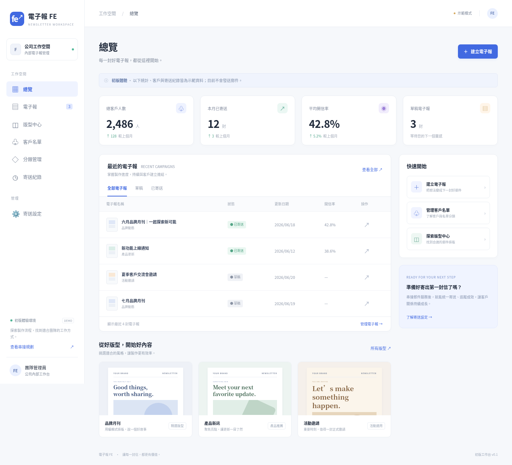

# 電子報 FE

公司內部電子報工作台的前端原型，繁體中文，純 HTML、CSS、JavaScript，無建置或外部套件依賴。

## 初版畫面



[手機版畫面](docs/mobile-preview.png)

## 啟動

```sh
cd /workspace/my-first-website
python3 -m http.server 8000 --bind 0.0.0.0
```

## 已實作

- 儀表板與示範統計、電子報搜尋／狀態篩選。
- 三種可編輯郵件版型：品牌月刊、產品新訊、活動邀請。
- 即時桌面／手機預覽，HTML 草稿匯出。
- 瀏覽器 localStorage 草稿新增、編輯、刪除與重新載入持久化。
- 示範客戶搜尋／分類篩選、固定內容分類、示範寄送紀錄。
- 寄送串接需求與後續階段說明。

## 界線

本版本為可公開展示的原型，沒有登入、資料庫、真實名單匯入、郵件發送、排程、退訂或實際追蹤功能。所有統計、客戶與歷史寄送均為虛構示範資料。草稿僅存在當前瀏覽器與網站來源，不同步裝置；清除網站資料會刪除草稿，應匯出備份。不要輸入機密或客戶個資。

郵件使用表格結構與行內樣式，不代表已通過 Outlook 等郵件客戶端相容性驗證。匯出檔是 HTML 草稿，正式寄送前必須補上公司地址、有效退訂連結與正式按鈕網址，並進行跨客戶端測試。

## 成熟服務規劃

進階拖拉式編輯可評估 Unlayer／Beefree；名單與寄送優先評估 Brevo 等成熟電子報平台，或以郵件 API 搭配受保護後端。正式上線需要登入與權限、資料庫、寄件網域驗證、退信／退訂處理、事件簽章驗證。API 金鑰不得存放於前端或儲存庫。

## GitHub Pages

推送 main 分支後，可在 GitHub 儲存庫 Settings → Pages → Deploy from a branch，選擇 main 與 /(root)，再儲存。發布後可透過 GitHub 顯示的網址查看。這只部署示範前端，不能作為正式內部系統使用。

## 驗證紀錄

已使用本機 Chromium 執行操作驗證：儀表板、三種版型、即時預覽與 HTML 跳脫、手機預覽、草稿儲存／重新載入／編輯／刪除、HTML 下載、電子報與客戶篩選、分類導覽、歷史紀錄對話框，以及 390px 手機選單與頁面寬度。測試過程未發現 JavaScript 頁面錯誤。這不代表已驗證實際寄送或郵件客戶端相容性。
